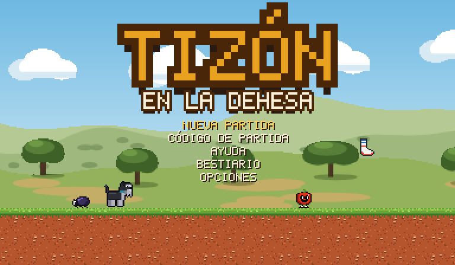
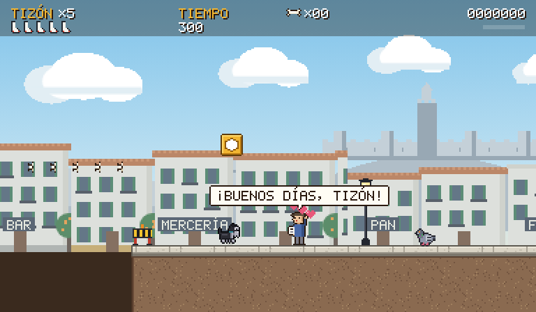
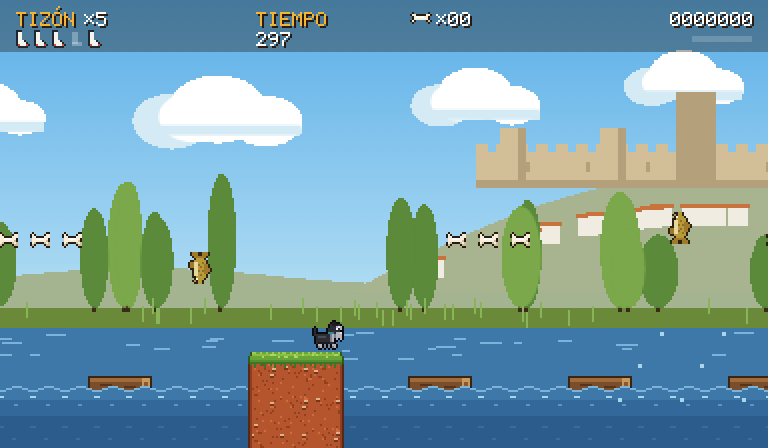
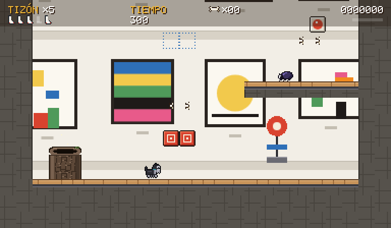
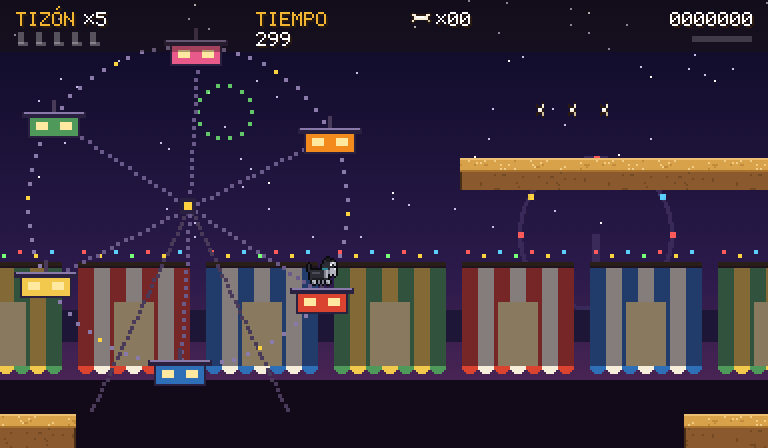
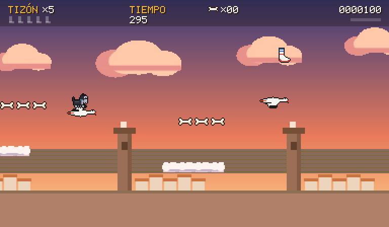
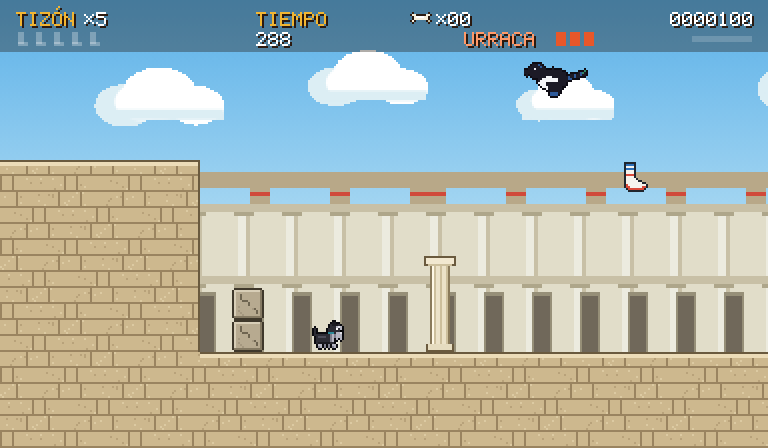
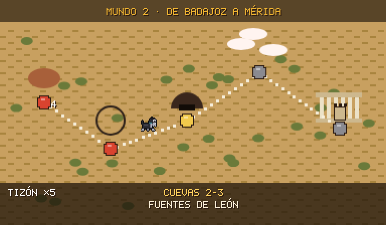
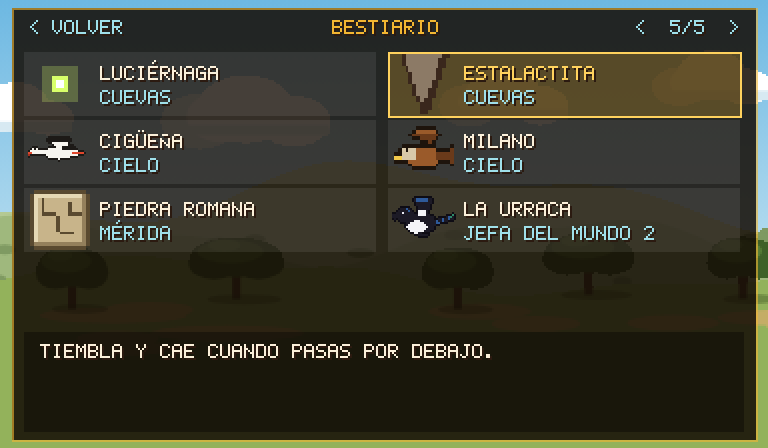

# Tizón en la Dehesa

Juego de plataformas al estilo de Super Mario World, hecho con **Godot 4**. Su protagonista es Tizón, un schnauzer mini de Badajoz. Recorre dos mundos, de la dehesa extremeña al Teatro Romano de Mérida, pasando por las calles de Badajoz, el Guadiana, el MEIAC, la Feria de San Juan y las cuevas de Fuentes de León.

**[▶ Jugar en el navegador](https://doverkan.github.io/tizon-en-la-dehesa/)**: no hay que instalar nada y funciona en el ordenador y en el móvil.

También se puede **instalar como aplicación**, con su icono, a pantalla completa y sin conexión. En Android y en el ordenador (Chrome o Edge), con el botón **Instalar la app**; en iPhone y iPad, desde Safari con **Compartir > Añadir a pantalla de inicio**.



| | |
|---|---|
|  |  |
|  |  |
|  |  |

## El juego

Entre nivel y nivel hay un **mapa del mundo**, desde el que también se pueden repetir los niveles ya superados. En cada nivel hay cinco **calcetines** escondidos y una **caseta** que hace de punto de control. Cien huesitos dan una vida.

**Mundo 1 · La dehesa y Badajoz**

1. **Dehesa 1-1 · Las encinas**: el primer paseo, con una madriguera secreta.
2. **Dehesa 1-2 · El atardecer**: más bichos y otra madriguera.
3. **Badajoz 1-3 · Desayuno en The Cereal Cafe**:
   - Los vecinos saludan a Tizón al pasar, los toldos rebotan y hay palomas por la acera.
   - Al final, Tizón entra a desayunar al café.
   - Está dedicado a Eduardo, su dueño.
4. **Guadiana 1-4 · El Puente de Palmas**: troncos que se hunden si te quedas encima y carpas que saltan del agua.
5. **Alcazaba 1-5 · Torre de Espantaperros**: pinchos, barras de fuego, rastrillos y, al final, **Micifuz**.

**Mundo 2 · De Badajoz a Mérida**

1. **MEIAC 2-1 · Los jardines del museo**: aspersores que lanzan hacia arriba (desde el chorro se puede saltar) y, dentro del museo, bloques rojos y azules que cambian con un interruptor.
2. **Feria 2-2 · La Feria de San Juan**: una noria con cabinas que giran, globos para subir, patos de la caseta de tiro y fuegos artificiales.
3. **Cuevas 2-3 · Fuentes de León**: todo está a oscuras; cada luciérnaga que coges da más luz.
4. **Cigüeñas 2-4 · El vuelo de las cigüeñas**: la pantalla avanza sola y hay que ir de cigüeña en cigüeña sobre las nubes.
5. **Mérida 2-5 · El Teatro Romano**: piedras que se desmoronan y, al final, **la Urraca**.

Además:

- **Ayuda, bestiario y opciones.** El bestiario reúne 38 personajes y objetos, con su dibujo y para qué sirven.
- **Partida guardada** automáticamente al tocar la caseta y al pasar un nivel.
- **Código de partida** de 21 caracteres para seguir en otro dispositivo. Es el mismo que usa la versión web del juego.
- **Ranking de jugadores**, el mismo en la web y en la app. Sale la mejor puntuación de cada jugador. Al acabar la partida, si la puntuación entra entre las 20 mejores, se escribe un nombre como en las recreativas. Se puede ver en [doverkan.com/tizon_ranking](https://www.doverkan.com/tizon_ranking/).
- **Mandos táctiles**: cruceta o joystick, y los botones A, B, X e Y en rombo. Con el pulgar entre dos botones se pulsan los dos (entre A y X, salto corriendo).
- Se exporta a **Windows, Linux, macOS, Android, iOS y web**.

| | |
|---|---|
|  |  |

## Cómo jugarlo

1. Instala **[Godot 4.4](https://godotengine.org/download/) o posterior**. Está probado en la 4.4.1.
2. Clona el repositorio o descarga el zip desde **Code > Download ZIP**.
3. En el gestor de proyectos de Godot pulsa **Importar** y elige `project.godot`.
4. Pulsa **Ejecutar** (F5). La primera vez tarda unos segundos en importar los gráficos y los sonidos.

Para crear el ejecutable de cada plataforma, el proyecto ya trae los preajustes en **Proyecto > Exportar**. Los pasos de cada una están en la [guía de desarrollo](docs/DESARROLLO.md#exportar-a-pc-android-ios-y-web).

## Subir y descargar cambios (Windows)

Con doble clic en `github.bat` se abre un menú para:
- ver el estado;
- descargar los cambios de GitHub y subir los tuyos;
- publicar una versión nueva del juego web (`docs/index.html`, que GitHub Pages sirve en la dirección de arriba);
- ver el historial.

Necesita [Git para Windows](https://git-scm.com/download/win). Si la carpeta todavía no está conectada con GitHub, el propio menú la prepara.

## Controles

| Acción | Teclado | Mando | Táctil |
|---|---|---|---|
| Moverse | ← → (o A D) | Cruceta o stick | Cruceta o joystick |
| Agacharse, meterse en una encina hueca, soltar el globo | ↓ | ↓ | ↓ |
| Saltar (mantén para subir más) | Z, Espacio | A | A |
| Correr, escupir fuego, coger conchas | X, Mayús | X o Y | X o Y |
| Vuelta en el aire | C | B | B |
| Pausa | Enter, P, Esc | Start | ❚❚ |

## Cómo está hecho

- **Todo el código está en GDScript** y comentado en castellano.
- **Los niveles se dibujan como mapas de texto** (`niveles/mapas/*.txt`), donde cada carácter es una casilla. `tools/construir.gd` los convierte en escenas de Godot, que también se pueden editar en el editor.
- **Los gráficos son pixel art original**, a 384 × 224 píxeles.
- **Los sonidos y la música son síntesis propia.** No hay recursos de terceros.

La [guía de desarrollo](docs/DESARROLLO.md) explica:
- la estructura de carpetas;
- cómo editar y añadir niveles;
- el atlas de losetas;
- el formato de la partida guardada y del código;
- la exportación a cada plataforma.

```
escenas/      Tizón, enemigos, objetos, jefes y decorado
niveles/      escenas de los 10 niveles y sus mapas de texto
scripts/      código del juego
assets/       gráficos, sonidos y datos (mapa del mundo, bestiario)
tiles/        TileSet con colisiones
tools/        constructor de niveles
exportar/     aquí deja Godot los juegos exportados
docs/         guía de desarrollo, capturas y el juego web (index.html, instalable como aplicación)
github.bat    menú para subir y descargar los cambios de GitHub (github.ps1)
```

## Versiones

- **1.3** (noviembre de 2026)
  - Ranking: sale una sola vez cada jugador, con su mejor puntuación. Si una partida no supera tu récord, el juego te dice en qué puesto sigue tu mejor puntuación.
- **1.2** (noviembre de 2026)
  - Móvil y tableta: un dedo puesto entre dos botones pulsa los dos (con el pulgar entre A y X se salta corriendo) y se puede deslizar de un botón a otro. Un toque corto en A ya da casi el salto entero. En la versión de Godot los botones son más grandes.
  - Para todos: un poco más de margen para saltar justo al salir de un borde o si se pulsa un pelín antes de caer.
  - MEIAC 2-1, el museo por dentro: hay un interruptor en el suelo, así que quien se cae hasta abajo puede volver a poner el color que necesita y subir otra vez. Los escalones de colores son más anchos y los saltos más cortos.
  - Cigüeñas 2-4: solo queda un milano, en la escalera de nubes, lejos de las cigüeñas, y después de caer se va por abajo. Las cigüeñas están a la misma altura que la nube desde la que se salta y algunas nubes son más anchas. Se puede pasar entero andando y con toques cortos.
  - Mérida 2-5: si se cae entre las columnas del teatro siempre se puede salir (el fondo de los huecos es de piedra).
- **1.1** (noviembre de 2026)
  - MEIAC 2-1: desde el chorro de los aspersores se puede saltar, y la zanja de los aspersores tiene columnas más bajas, más anchas y más juntas.
  - Cigüeñas 2-4: más fácil. La pantalla avanza más despacio, las nubes son más anchas y los huecos más cortos. Hay 4 milanos en vez de 7: se quedan quietos en lo alto, avisan temblando y graznando, y solo se dejan caer si Tizón pasa justo por debajo.
- **1.0** (noviembre de 2026): primera versión publicada.

## Créditos

- Creado por **Nacho Cano** (DoverKan).
- **Tizón** es el perro de verdad que protagoniza el juego.
- El nivel de Badajoz está dedicado a **Eduardo**, de **The Cereal Cafe**, donde Tizón desayuna cada día.
- Hecho con [Godot Engine](https://godotengine.org).
